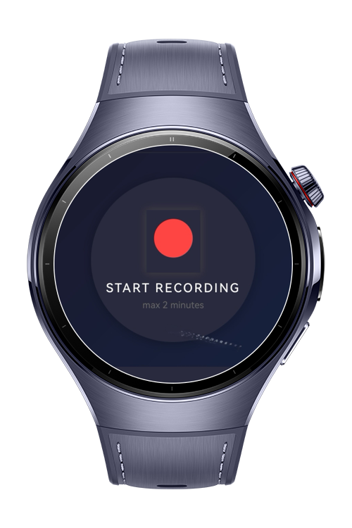
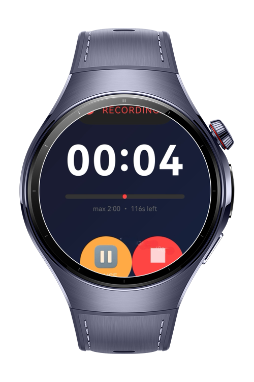
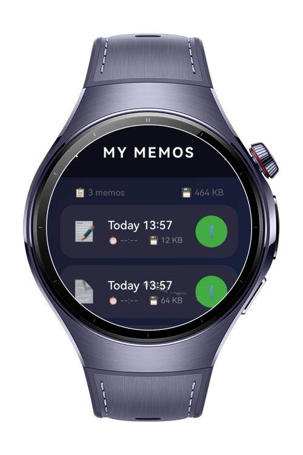
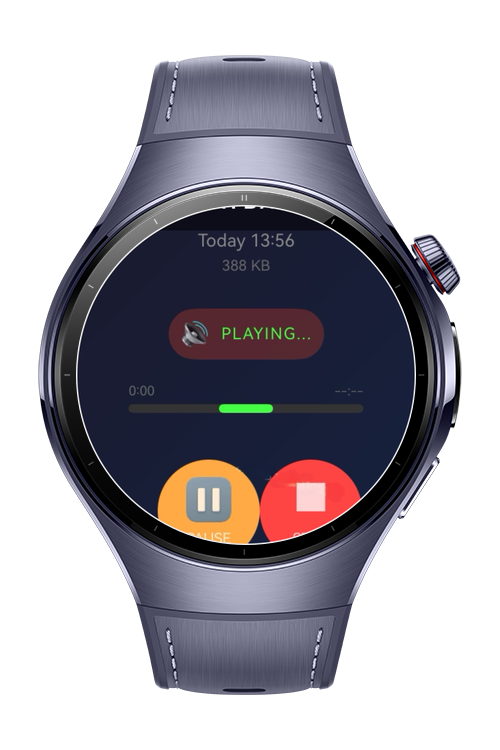

> **Note:** To access all shared projects, get information about environment setup, and view other guides, please visit [Explore-In-HMOS-Wearable Index](https://github.com/Explore-In-HMOS-Wearable/hmos-index).

# How To Build Voice Memo Recorder

`How To Build Voice Memo Recorder` is a voice memo application designed for HarmonyOS smart wearables. It allows users to quickly record voice notes directly from their watch, play them back with intelligent audio handling, and manage recordings - all optimized for small screen wearable devices.

# Preview
<p align="left">
   
  
  
  
</p>

# Use Cases

- Quick idea capture - Record sudden thoughts without taking out your phone
- Meeting notes - Capture important points during meetings
- Shopping lists - Dictate items while cooking or walking
- Voice reminders - Leave quick voice notes for yourself
- Lecture recording - Record short segments of lectures or presentations
- Call interruption handling - Automatically pauses recording when phone calls arrive, resumes after call ends
- Bluetooth headset support - Seamless playback through connected Bluetooth devices
- Memo management - List, play, and delete recorded memos directly from watch

# Technology

## Stack
- Languages: ArkTS, ArkUI
- Frameworks: HarmonyOS SDK 6.0.1(21)
- Tools: DevEco Studio Vers 6.0.1
- Libraries
    | Audio APIs  | @ohos.multimedia.audio (AudioCapturer, AudioRenderer, AudioManager) |
    | File I/O    | @ohos.file.fs                                                       |

## Required Permissions
The following permissions must be declared in `module.json5`:

- "ohos.permission.MICROPHONE"
- "ohos.permission.STORAGE_MANAGER"

# Directory Structure
```
entry/src/main/ets/
├── entryability/
│   └── EntryAbility.ets          # App entry, permission requests
├── pages/
│   ├── Index.ets                 # Main screen (Record + List)
│   ├── RecordPage.ets            # Recording UI with timer
│   ├── MemoListPage.ets          # List of saved memos
│   └── PlaybackPage.ets          # Playback controls
├── common/
│   ├── AudioService.ets          # Singleton audio operations
│   ├── FileService.ets           # File save/load/delete
│   └── WaveformRenderer.ets      # Canvas waveform drawing (optional)
└── model/
    └── MemoModel.ets             # Data model for memos
```

# Constraints and Restrictions

## Supported Device
- Huawei Watch 5 Series
- HarmonyOS Wearable devices (API 9+)
- DevEco Studio Simulator (with audio simulation)
 
## Technical Constraints
Constraint	                |      Value
-------------------------------------------------------------------
Max recording duration	    |      2 minutes (120 seconds)
Audio format	            |      PCM 16-bit, 16kHz, mono
File extension	            |      .pcm
Chunk size	                |      4096 bytes
Max stored memos	        |      ~50 (approx 5MB)
Minimum battery	            |      No limit (auto-stop at low battery)

# License (MIT)
`How To Build Voice Memo Recorder` is distributed under the terms of the MIT License. See the [LICENSE](./LICENSE) for more information.